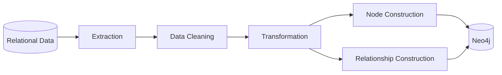

# SQL to Neo4j | ETL Pipeline

  <strong>Bridging relational databases and graph data modeling with Python.</strong>

  

  
  
  
  

---

## Overview

This project explores the transformation of relational data into a graph-oriented structure using Python and Neo4j.

It demonstrates an ETL (Extract, Transform, Load) approach to data migration, with a focus on data preparation, entity construction, and relationship modeling.

By moving from relational structures to a graph representation, the project illustrates how interconnected data can be organized for graph-based querying and analysis.

## Architecture

**Explore the architecture:** [View the interactive project diagram](https://gitdiagram.com/medseddik1999/etl-from-sql-to-neo4j?utm_source=readme&utm_medium=badge)

*Conceptual representation of the ETL workflow.*

## Core Components

| Component | Purpose |
|---|---|
| Data cleaning | Prepare and standardize source data |
| Node construction | Represent entities as graph nodes |
| Relationship construction | Model connections between entities |
| Migration logic | Support the transfer of graph data |

## Technical Focus

- **ETL & Data Integration:** Structuring data transformation and migration workflows.
- **Python Data Processing:** Organizing reusable functions for data preparation.
- **Graph Data Modeling:** Translating entities and relationships into graph structures.
- **Relational-to-Graph Migration:** Exploring an alternative representation of structured data.
- **Neo4j:** Working with graph-oriented data storage and relationships.

## Why Graph Databases?

Relational databases are effective for structured records, while graph databases provide a natural representation of connected entities.

Representing data as nodes and relationships can make relationship-centric queries and network analysis more intuitive.

This project explores that transition and the engineering concepts behind it.

## Author

**Abdelhakim Seddik** — Data Scientist

- GitHub: [@medseddik1999](https://github.com/medseddik1999)
- LinkedIn: [Connect with me](https://www.linkedin.com/in/abdelhakim-mohamed-seddik-a70474194/)

---

  <i>Exploring data engineering, graph databases, and connected-data architectures.</i>

